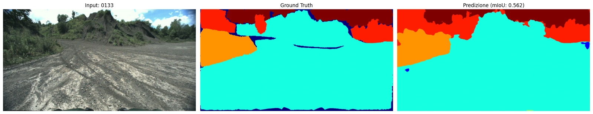
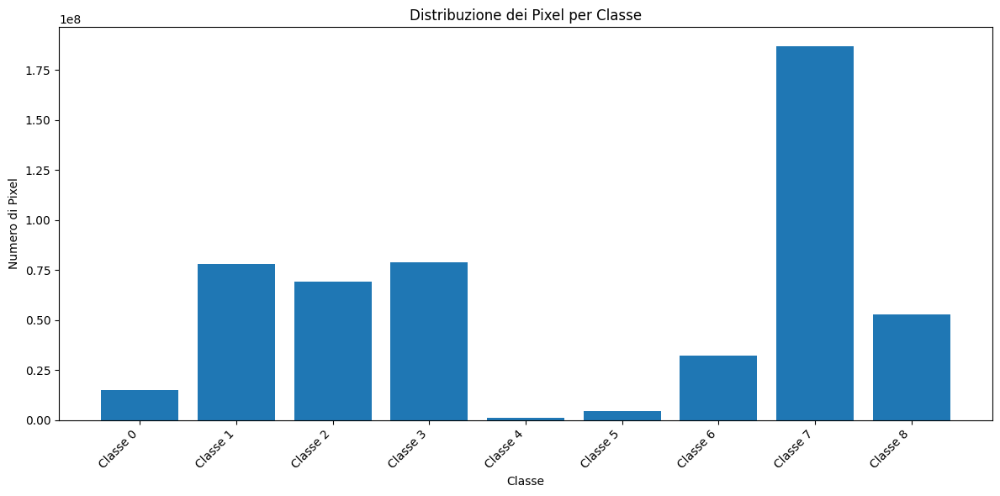
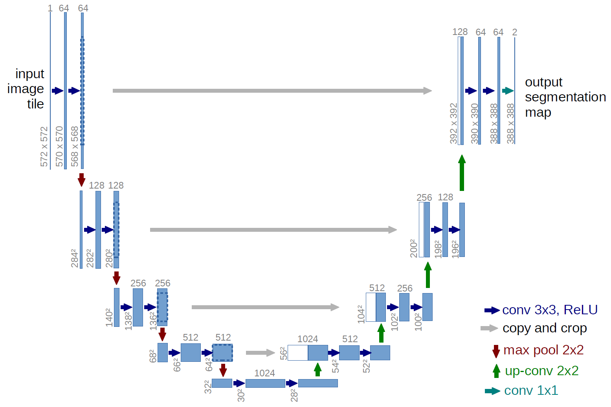
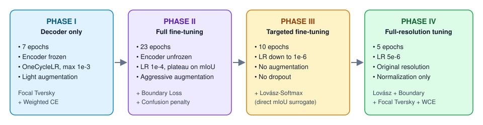
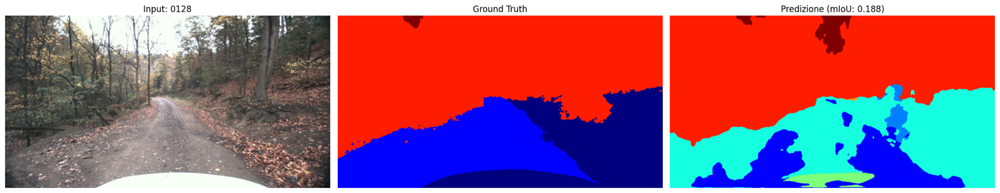
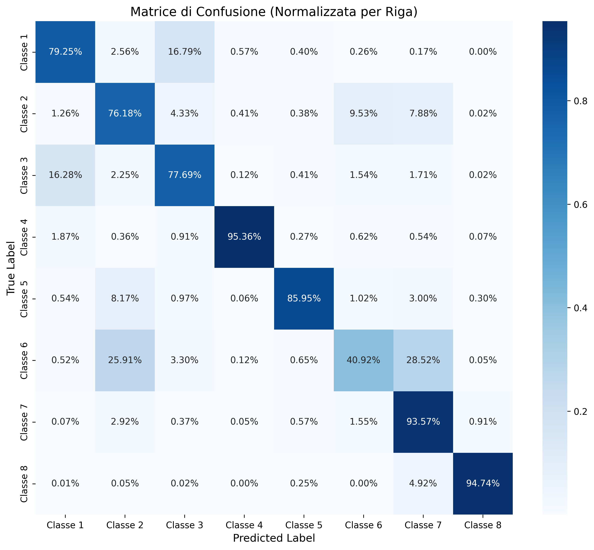

# 🚜 Autoencoder-Based Onboard Image Segmentation

> Pixel-wise semantic segmentation of **off-road rural scenes** from a vehicle-mounted camera, built for the *Machine Learning* course of the **MSc in Computer Engineering** at the **University of Salerno** (A.Y. 2024/2025).

<p align="center">
  
</p>

<p align="center">
  
  
  
  
  
</p>

---

## 📌 Overview

A camera mounted on a vehicle driving through rural environments captures still frames. The goal is to **classify every pixel** into one of **8 semantic classes** (plus a background/ignore label `0`):


|---|---|---|---|
| ☁️ sky | 🪨 rough trail | 🛤️ smooth trail | 🌱 traversable grass |
| 🌳 high vegetation | 🌿 non-traversable low vegetation | 💧 puddle | 🚧 obstacle |

The task comes with three hard constraints:

- **Small dataset:** only **931** labelled images, and the training set **cannot be extended** with external data.
- **Highly variable lighting:** daylight frames with shadows, backlight and changing exposure.
- **Limited compute:** everything must run on **Google Colab**, using **< 5 GB GPU RAM in training** and **< 4 GB in test**.

The model is evaluated on a private test set with the **per-class mean Intersection-over-Union (mIoU)**, balanced against GPU memory and frame rate.

## 🏆 Results

| Metric | Value | Constraint |
|---|---|---|
| **mIoU (validation)** | **65.33 %** | larger is better |
| GPU RAM, training | **3.2 GB** | < 5 GB ✅ |
| GPU RAM, test | **3.5 GB** | < 4 GB ✅ |

---

## 📊 1. Dataset Analysis

<p align="center">
  
</p>

The pixel distribution is **heavily imbalanced**. A few classes (such as high vegetation and sky) dominate the frames, while others, like puddles and low vegetation, cover only a tiny fraction of pixels. Handling this imbalance shaped almost every later design choice.

### Leakage-free, stratified split (80 / 20)

Frames come from continuous driving sequences, so many images are **near-duplicates**. A random split would leak almost identical frames into validation and inflate the score. Instead we:

1. compute a **perceptual hash** (`imagehash`) for every RGB image;
2. build a **similarity graph** (`networkx`), where an edge links two visually similar images;
3. treat each **connected component** as a group and split **at group level**, so similar frames never land on both sides;
4. **stratify** groups by the presence of rare classes, so both sets contain them.

## 🧪 2. Pre-processing & Data Augmentation

- Resize + crop to the model input resolution; RGB normalized to `[0, 1]` (`float32`), masks kept as `uint8` → `long`.
- **Online augmentation on GPU with [Kornia](https://kornia.github.io/)**, so every batch sees new transformations: horizontal flip, brightness/contrast jitter, small rotations, blur and **CutMix**.
- **Phase-dependent intensity:** light → aggressive → off → off (see training below).
- **Class-selective augmentation:** duplicating a whole image to oversample a rare class also oversamples the dominant classes around it. Instead we extract a **crop centred on the rare region** (with some context) and set every other pixel to `ignore_index`, so the loss only sees the class we want to boost.

## 🧠 3. Model Architecture

<p align="center">
  
  <br><sub>U-Net diagram from Ronneberger et al., 2015</sub>
</p>

- **U-Net** encoder–decoder (via `segmentation-models-pytorch`).
- **Encoder:** **EfficientNet-B5** pre-trained on **ImageNet**, extracting multi-scale features.
- **Decoder:** progressive up-sampling to reconstruct a full-resolution semantic map.
- **Skip connections** between symmetric levels, to recover the fine spatial detail lost while down-sampling.
- **Head:** `1×1` convolution with **9 output channels** (8 classes + background) + Softmax → an `M×N×9` probability map.

## ⚙️ 4. Loss Design

No single loss could handle imbalance, boundary quality *and* the mIoU metric at once, so the objective is a **modular combination**:

| Component | Purpose |
|---|---|
| **Focal Tversky Loss** (α = 0.7, β = 0.3, γ = 2.0) | Penalises false negatives more heavily, which boosts recall on rare classes |
| **Weighted Cross-Entropy** | Class weights inversely proportional to pixel frequency, plus an extra boost for the rarest classes |
| **Boundary Loss** | Weighs errors near ground-truth edges more, giving sharper transitions (e.g. *trail* vs *grass*) |
| **Dynamic confusion penalty** | Estimates the confusion matrix **on the current batch** and penalises the most-confused class pairs in real time |
| **Lovász-Softmax Loss** | Differentiable surrogate of IoU that aligns the training objective with the evaluation metric |
| ~~Pixel Contrastive Loss~~ | Tried on encoder features to separate similar classes; later dropped as too expensive |

```text
Loss_seg   = 0.8 · FocalTversky + 0.2 · WeightedCE
Loss_total = Loss_seg + 2.0 · BoundaryLoss + ConfusionPenalty     (phases II–III)
```

## 🔁 5. Four-Phase Training Strategy

<p align="center">
  
</p>

The model started overfitting after only a few epochs, so training was split into **four phases (45 epochs in total)**:

1. **Decoder only:** with the ImageNet encoder frozen, the decoder adapts to the task without destroying pre-trained features.
2. **Full fine-tuning:** the whole network is unfrozen, with aggressive augmentation, Boundary Loss and the confusion penalty.
3. **Targeted fine-tuning:** augmentation and dropout are turned off, the LR is very low and Lovász-Softmax is added to polish details.
4. **Full-resolution fine-tuning:** training on original-size images with normalization only, matching real inference conditions.

**Hyperparameters:** AdamW (weight decay `1e-6`), OneCycleLR in phase I, then `ReduceLROnPlateau` on validation mIoU (patience 3, factor 0.5), batch size `3`, mixed precision (AMP). The checkpoint is saved **whenever validation mIoU reaches a new best**.

---

## 🔍 6. Qualitative Analysis

**✅ Success case.** Trail, vegetation and sky are well separated, with clean boundaries:

<p align="center"></p>

**❌ Failure case.** A leaf-covered forest trail: the visual ambiguity between trail types and grass under heavy shadow confuses the model:

<p align="center"></p>

### Confusion matrix (validation, row-normalised)

<p align="center"></p>

Most classes are recognised with **76–95 %** per-pixel recall. The remaining errors sit between **visually similar classes**, such as classes 1 ↔ 3 (~16 % each way) and class 6, which is often absorbed by classes 2 and 7. The dynamic confusion penalty was designed to target exactly these pairs.

---

## 📁 Repository Structure

```text
autoencoder-onboard-segmentation/
├── dataset/
│   ├── training/
│   │   ├── train/                  # original images + label masks
│   │   ├── augmented/              # offline augmentation for rare classes
│   │   └── augmented_aggressive/   # class-selective crops
│   └── testing/
├── notebooks/
│   ├── 0 - Data Analysis/          # class distribution, pre-game analysis
│   ├── 1 - Bilanciamento/          # balancing & data augmentation experiments
│   ├── 3 - Loss/                   # loss function experiments
│   ├── 4 - First Model/            # first baseline model
│   └── PreTrainedModel/            # SMP pre-trained encoders, adaptive LR
├── local_execution/
│   ├── Fra/                        # final training pipeline, test & profiling scripts
│   └── Leo/old/                    # earlier iterations (baselines, two-phase, focal…)
└── docs/images/                    # figures used in this README
```

## 🚀 Getting Started

```bash
git clone https://github.com/LeonardoLuongo/autoencoder-onboard-segmentation.git
cd autoencoder-onboard-segmentation
pip install torch torchvision segmentation-models-pytorch kornia albumentations \
            opencv-python imagehash networkx scikit-learn matplotlib seaborn tqdm
```

**Train** (all four phases, saves the best checkpoint by validation mIoU):

```bash
cd local_execution/Fra
python "7 - All_in_2.py"
```

**Test / inference:** `local_execution/Fra/test_prof.py` loads the checkpoint and implements the `predict` function required by the specification:
- **input:** `uint8` tensor of shape `(batch_size, rows, cols, 3)`;
- **output:** `uint8` tensor of shape `(batch_size, rows, cols, 1)` with class IDs, same format as the label files.

> Model weights (`*.pth`) are not tracked in git.

## 🛠️ Tech Stack

**PyTorch** · **segmentation-models-pytorch** · **Kornia** · **Albumentations** · **OpenCV** · **imagehash** · **NetworkX** · **scikit-learn** · **Matplotlib / Seaborn** · **Google Colab**

## 👥 Authors

**Group 65**
- [Leonardo Luongo](https://github.com/LeonardoLuongo)
- [Francesco Monda](https://github.com/cescomonda)

Supervised by **Prof. Mario Vento** and **Prof. Diego Gragnaniello**, University of Salerno, DIEM.
